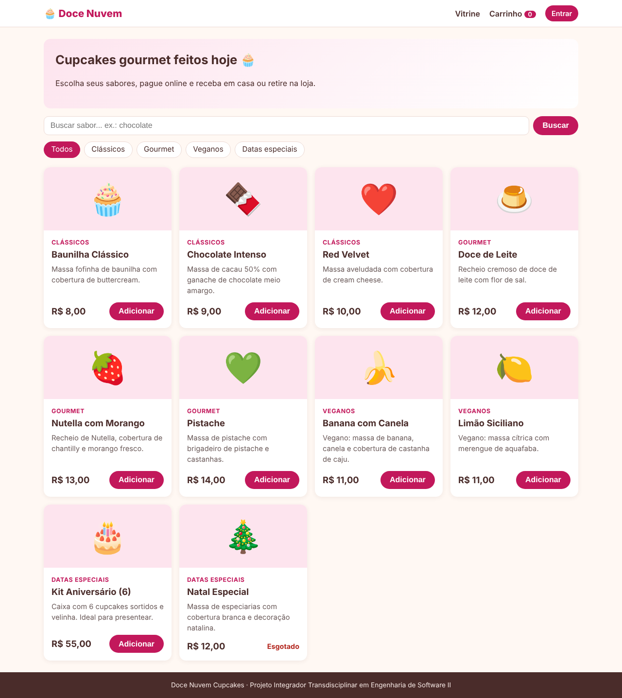

# 🧁 Doce Nuvem Cupcakes

Loja virtual de cupcakes gourmet com **vitrine, pedido eletrônico, pagamento e entrega**.

Projeto Integrador Transdisciplinar em Engenharia de Software II, Universidade Cruzeiro do Sul.
**Aluna:** Heloiza Janke Barbosa · **RGM:** 32446748



## Funcionalidades

**Cliente**
- Vitrine com filtro por categoria e busca por sabor
- Cadastro, login e logout (senha criptografada)
- Carrinho com controle de estoque e pedido mínimo de R$ 20,00
- Entrega em casa (R$ 7,00) ou retirada na loja (grátis)
- Pagamento por PIX, cartão de crédito (validado) ou dinheiro na entrega, em modo simulado
- Acompanhamento do pedido em linha do tempo e cancelamento enquanto não está em preparo

**Loja (administrador)**
- Lista de pedidos com filtro por status e avanço de etapas
- Cadastro, edição e retirada de cupcakes da vitrine

## Tecnologias

Python 3 · Flask (padrão **MVC**) · SQLite · HTML5 · CSS3 · JavaScript · pytest

## Como rodar

**No navegador (sem instalar nada):** no GitHub, clique em **Code → Codespaces → Create codespace on main** e, no terminal, digite:

```bash
pip install -r requirements.txt
python run.py
```

**No computador** (com Python 3 instalado): os mesmos comandos, e depois abra http://127.0.0.1:5000.

| Perfil | E-mail | Senha |
|---|---|---|
| Administrador | admin@docenuvem.com | admin123 |
| Cliente | crie a sua conta no sistema | |

Cartão de teste: `4111 1111 1111 1111`, validade futura, qualquer CVV.

## Testes

```bash
pytest
```

Resultado: **51 testes aprovados** (unitários e de integração).

## Documentação

| Situação-problema | Documento |
|---|---|
| **1 – Planejamento revisado** | [Escopo, histórias de usuário, backlog e requisitos](docs/situacao-1-planejamento/01-escopo-e-historias.md) |
| | [Modelagem UML: casos de uso, classes, sequência, atividades e estados](docs/situacao-1-planejamento/02-modelagem-uml.md) |
| | [Banco de dados: conceitual, lógico normalizado, físico e dicionário de dados](docs/situacao-1-planejamento/03-banco-de-dados.md) |
| | [IHC: princípios, mapa navegacional, mapa conceitual, telas e mensagens](docs/situacao-1-planejamento/04-ihc-interface.md) |
| **2 – Desenvolvimento** | [Arquitetura MVC e tratamento de erros](docs/situacao-2-desenvolvimento/01-arquitetura-mvc.md) |
| | [Manual de uso](docs/situacao-2-desenvolvimento/02-manual-de-uso.md) |
| | Código-fonte: [`app/`](app/) · Banco: [`database/`](database/) · Testes: [`tests/`](tests/) |
| **3 – Testes e validação** | [Plano e resultados dos testes (verificação e validação)](docs/situacao-3-testes/01-plano-e-resultados-dos-testes.md) |
| | [Roteiro do vídeo](docs/situacao-3-testes/02-roteiro-do-video.md) |
| | [Formulário de teste para usuários](docs/situacao-3-testes/03-formulario-teste-usuarios.md) |
| | [Feedback recebido e melhorias aplicadas](docs/situacao-3-testes/04-melhorias-aplicadas.md) |
| | [Laudos dos 5 testadores](docs/situacao-3-testes/laudos-testes-usuarios/) |

**Vídeo de apresentação:** _(colar aqui o link do YouTube/Drive)_

## Estrutura

```
app/models/        → Model: regras de negócio e acesso ao banco
app/controllers/   → Controller: recebe requisições e escolhe a tela
app/templates/     → View: páginas HTML
app/static/        → View: CSS e JavaScript
database/          → scripts SQL (schema e dados iniciais)
tests/             → testes automatizados (pytest)
docs/              → documentação, organizada por situação-problema
```
