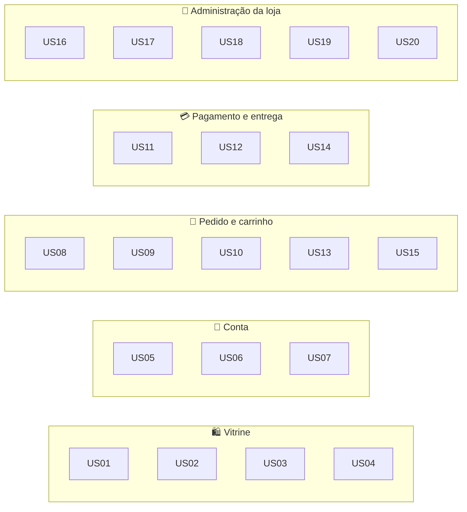

# 1. Escopo revisado e histórias de usuário

## 1.1 Contexto do negócio

A **Doce Nuvem Cupcakes** é uma loja de cupcakes gourmet que quer vender pela internet. O dono já teve um aplicativo feito por outra empresa que não funcionava, gerou reclamações e foi tirado do ar. Por isso, este projeto prioriza **poucas funções, bem feitas e testadas**, com foco em quatro pontos pedidos pelo cliente:

1. **Vitrine virtual** – mostrar os cupcakes com foto, descrição, preço e disponibilidade.
2. **Pedido eletrônico** – carrinho de compras e finalização do pedido.
3. **Pagamento** – PIX, cartão de crédito ou dinheiro na entrega.
4. **Entrega** – entrega em casa (com taxa) ou retirada na loja, com acompanhamento do status.

## 1.2 Revisão do escopo (Kaizen / melhoria contínua)

Na revisão do planejamento do PITE I, foram feitas as seguintes decisões para tornar o projeto executável:

| Decisão | Motivo |
|---|---|
| Aplicação **web responsiva** (funciona no celular) em vez de app nativo | Um só código para celular e computador; o cliente acessa pelo navegador sem instalar nada. |
| **Pagamento simulado** (sem cobrança real) | Integrar um gateway real (Mercado Pago, PagSeguro) exige contrato e CNPJ. O sistema valida o cartão (16 dígitos, algoritmo de Luhn, validade e CVV) como um gateway faria, e a integração real fica para uma próxima versão. |
| Taxa de entrega **fixa** (R$ 7,00) | Simplifica a regra para a primeira versão. Cálculo por distância/CEP fica no backlog. |
| Área do **administrador** incluída | Sem ela, a loja não consegue atualizar o status das entregas nem cadastrar cupcakes. |
| Fora do escopo desta versão | Avaliações dos clientes, cupons de desconto, programa de fidelidade, notificações por WhatsApp. |

## 1.3 Atores

- **Visitante** – pessoa que ainda não tem conta ou não entrou.
- **Cliente** – pessoa cadastrada que faz pedidos.
- **Administrador (loja)** – funcionário da loja que gerencia cupcakes e pedidos.

## 1.4 Histórias de usuário (cartões)

Modelo usado em cada cartão: ID, título, requerente, ação ("Como… quero… para…"), critérios de aceitação (CA), regras de negócio (RN), requisitos não funcionais (RNF), prioridade e pontos.

| ID | Título | História | Critérios de aceitação | RN / RNF | Prior. | Pts |
|---|---|---|---|---|---|---|
| US01 | Ver vitrine | Como **visitante**, quero ver os cupcakes com foto, descrição e preço, para escolher o que comprar. | CA1: a vitrine mostra só cupcakes ativos. CA2: cupcake sem estoque aparece como "Esgotado" e sem botão de compra. | RNF01 responsivo | A | 3 |
| US02 | Filtrar por categoria | Como visitante, quero filtrar por categoria (Clássicos, Gourmet, Veganos, Datas especiais), para achar mais rápido. | CA1: ao clicar numa categoria, só ela aparece. CA2: "Todos" volta a lista completa. | — | B | 2 |
| US03 | Buscar sabor | Como visitante, quero buscar pelo nome do sabor, para encontrar um cupcake específico. | CA1: a busca procura no nome e na descrição. CA2: sem resultado, mostra mensagem e link para ver todos. | — | B | 2 |
| US04 | Ver detalhes | Como visitante, quero abrir a página de um cupcake, para ver detalhes e quantas unidades há. | CA1: mostra estoque disponível. CA2: cupcake inexistente mostra erro 404 amigável. | — | B | 1 |
| US05 | Criar conta | Como visitante, quero criar uma conta, para poder fazer pedidos. | CA1: nome, e-mail e senha são obrigatórios. CA2: mostra o erro de cada campo. CA3: após cadastrar, já entra logado. | RN01 e-mail único; RN02 senha ≥ 6; RNF02 senha criptografada | A | 3 |
| US06 | Entrar (login) | Como cliente, quero entrar com e-mail e senha, para acessar meus pedidos. | CA1: dados errados mostram "E-mail ou senha incorretos" sem dizer qual. CA2: o carrinho montado antes do login é mantido. | RNF02 | A | 2 |
| US07 | Sair (logout) | Como cliente, quero sair da conta, para proteger meus dados em computador compartilhado. | CA1: após sair, páginas restritas pedem login. | — | B | 1 |
| US08 | Adicionar ao carrinho | Como visitante, quero colocar cupcakes no carrinho, para comprar vários de uma vez. | CA1: o contador do carrinho no topo é atualizado. CA2: não deixa passar do estoque. | RN05 estoque | A | 3 |
| US09 | Alterar carrinho | Como cliente, quero mudar quantidades e remover itens, para ajustar meu pedido. | CA1: quantidade 0 remove o item. CA2: subtotal recalculado. | RN05 | A | 2 |
| US10 | Pedido mínimo | Como **dono da loja**, quero exigir pedido mínimo, para que a entrega compense. | CA1: abaixo de R$ 20,00 o botão "Finalizar" não aparece e o sistema diz quanto falta. | RN03 | A | 1 |
| US11 | Escolher entrega ou retirada | Como cliente, quero escolher entre receber em casa ou retirar na loja, para pagar menos quando puder buscar. | CA1: entrega soma R$ 7,00 e exige endereço. CA2: retirada é grátis. CA3: o total muda na hora. | RN04 | A | 3 |
| US12 | Pagar | Como cliente, quero pagar por PIX, cartão ou dinheiro na entrega, para usar a forma que preferir. | CA1: cartão inválido ou vencido mostra o erro e não cria o pedido. CA2: PIX e cartão válidos ficam "Aprovado". CA3: dinheiro fica "Pendente" até a entrega. | RN06; RNF03 só guarda os 4 últimos dígitos | A | 5 |
| US13 | Confirmação do pedido | Como cliente, quero ver a confirmação com número, itens e total, para ter certeza de que deu certo. | CA1: mostra nº do pedido, itens, forma de pagamento e total. CA2: o carrinho é esvaziado. | — | A | 2 |
| US14 | Acompanhar pedido | Como cliente, quero ver o andamento (Recebido → Em preparo → Saiu para entrega → Entregue), para saber quando chega. | CA1: linha do tempo com a etapa atual destacada. CA2: o cliente só vê os próprios pedidos. | RN08; RNF04 privacidade | A | 3 |
| US15 | Cancelar pedido | Como cliente, quero cancelar um pedido feito por engano, para não ser cobrado. | CA1: só cancela se ainda estiver "Recebido". CA2: pede confirmação. CA3: estoque volta. | RN07 | B | 2 |
| US16 | Gerenciar pedidos | Como **administrador**, quero ver todos os pedidos e filtrar por status, para organizar a produção. | CA1: lista com cliente, tipo, total e pagamento. CA2: filtro por status. | — | A | 3 |
| US17 | Avançar status | Como administrador, quero mudar o pedido para a próxima etapa, para informar o cliente. | CA1: só permite a próxima etapa do fluxo. CA2: ao entregar em dinheiro, o pagamento vira "Aprovado". | RN08 | A | 2 |
| US18 | Cadastrar cupcakes | Como administrador, quero cadastrar e editar cupcakes, para manter a vitrine atualizada. | CA1: preço > 0 e estoque ≥ 0. CA2: categoria obrigatória. | — | A | 3 |
| US19 | Tirar da vitrine | Como administrador, quero tirar um cupcake da vitrine sem apagá-lo, para não perder o histórico dos pedidos. | CA1: cupcake inativo some da vitrine mas continua nos pedidos antigos. | — | C | 1 |
| US20 | Área restrita | Como dono da loja, quero que só administradores acessem a área da loja, para proteger os dados. | CA1: cliente que tenta acessar recebe erro 403. | RNF04 | A | 1 |

### Regras de negócio

| Código | Regra |
|---|---|
| RN01 | Cada e-mail só pode ter uma conta (sem diferenciar maiúsculas). |
| RN02 | A senha precisa ter pelo menos 6 caracteres. |
| RN03 | O pedido mínimo é de R$ 20,00 (sem contar a taxa de entrega). |
| RN04 | Entrega em casa custa R$ 7,00. Retirada na loja é grátis. |
| RN05 | Não é possível comprar mais unidades do que há em estoque. O estoque é baixado quando o pedido é confirmado. |
| RN06 | Cartão: 16 dígitos, número válido pelo algoritmo de Luhn, não vencido e CVV com 3 dígitos. |
| RN07 | O cliente só pode cancelar o pedido enquanto o status for "Recebido". O estoque é devolvido. |
| RN08 | O status segue sempre a ordem: Recebido → Em preparo → Saiu para entrega (ou Pronto para retirada) → Entregue. |

### Requisitos não funcionais

| Código | Requisito |
|---|---|
| RNF01 | Usabilidade: a interface funciona em celular (a partir de 360 px de largura) e computador. |
| RNF02 | Segurança: senhas guardadas com hash (PBKDF2/scrypt via Werkzeug), nunca em texto puro. |
| RNF03 | Segurança: o número completo do cartão nunca é gravado; só os 4 últimos dígitos. |
| RNF04 | Privacidade: um cliente não consegue ver pedidos de outro; área administrativa protegida. |
| RNF05 | Acessibilidade: campos com rótulo, navegação por teclado, mensagens anunciadas a leitores de tela, contraste adequado. |
| RNF06 | Manutenibilidade: arquitetura MVC e testes automatizados que rodam com um comando (`pytest`). |
| RNF07 | Tratamento de erros: nenhuma tela técnica de erro aparece para o usuário (páginas 403, 404 e 500 próprias). |

## 1.5 Mapa de afinidade

Histórias agrupadas por tema:

## 1.6 Backlog do produto priorizado

| Ordem | ID | História | Tema | Pontos | Sprint |
|---|---|---|---|---|---|
| 1 | US01 | Ver vitrine | Vitrine | 3 | 1 |
| 2 | US05 | Criar conta | Conta | 3 | 1 |
| 3 | US06 | Entrar | Conta | 2 | 1 |
| 4 | US08 | Adicionar ao carrinho | Pedido | 3 | 1 |
| 5 | US09 | Alterar carrinho | Pedido | 2 | 1 |
| 6 | US10 | Pedido mínimo | Pedido | 1 | 1 |
| 7 | US11 | Entrega ou retirada | Pagamento/entrega | 3 | 2 |
| 8 | US12 | Pagar | Pagamento/entrega | 5 | 2 |
| 9 | US13 | Confirmação do pedido | Pedido | 2 | 2 |
| 10 | US20 | Área restrita | Administração | 1 | 2 |
| 11 | US16 | Gerenciar pedidos | Administração | 3 | 2 |
| 12 | US17 | Avançar status | Administração | 2 | 3 |
| 13 | US14 | Acompanhar pedido | Pagamento/entrega | 3 | 3 |
| 14 | US18 | Cadastrar cupcakes | Administração | 3 | 3 |
| 15 | US04 | Ver detalhes | Vitrine | 1 | 3 |
| 16 | US02 | Filtrar por categoria | Vitrine | 2 | 4 |
| 17 | US03 | Buscar sabor | Vitrine | 2 | 4 |
| 18 | US07 | Sair | Conta | 1 | 4 |
| 19 | US15 | Cancelar pedido | Pedido | 2 | 4 |
| 20 | US19 | Tirar da vitrine | Administração | 1 | 4 |

**Backlog futuro (fora desta versão):** integração com gateway de pagamento real, taxa de entrega por CEP, avaliações dos cupcakes, cupons, aviso de status por WhatsApp/e-mail, recuperação de senha por e-mail.

## 1.7 Exemplo de tarefas de uma história (US12 – Pagar)

| Tarefa | Estimativa |
|---|---|
| Criar tabela `pagamento` e relacionamento 1:1 com `pedido` | 2 h |
| Implementar validação de cartão (Luhn, validade, CVV) no Model | 3 h |
| Criar campos de pagamento no checkout com máscara e exibição condicional (JS) | 3 h |
| Gravar pedido, itens, baixa de estoque e pagamento numa única transação | 3 h |
| Escrever testes unitários de pagamento e de pedido recusado | 2 h |
