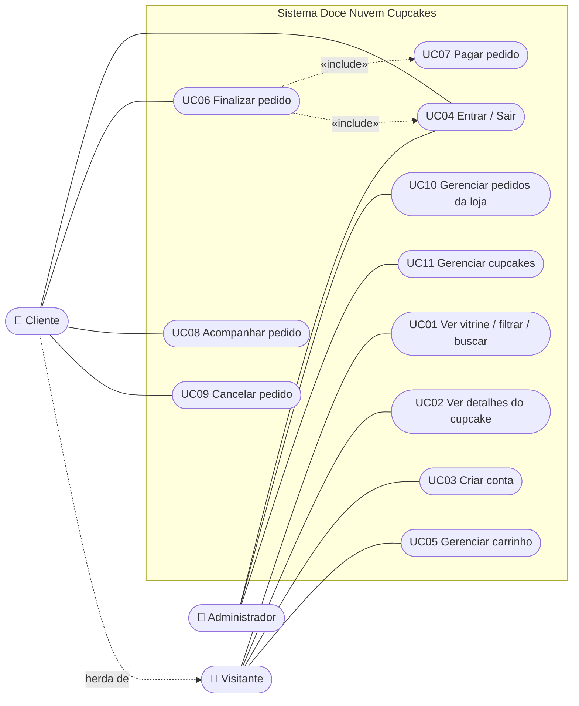
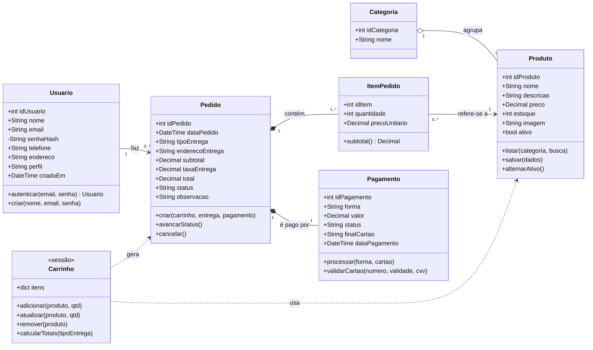
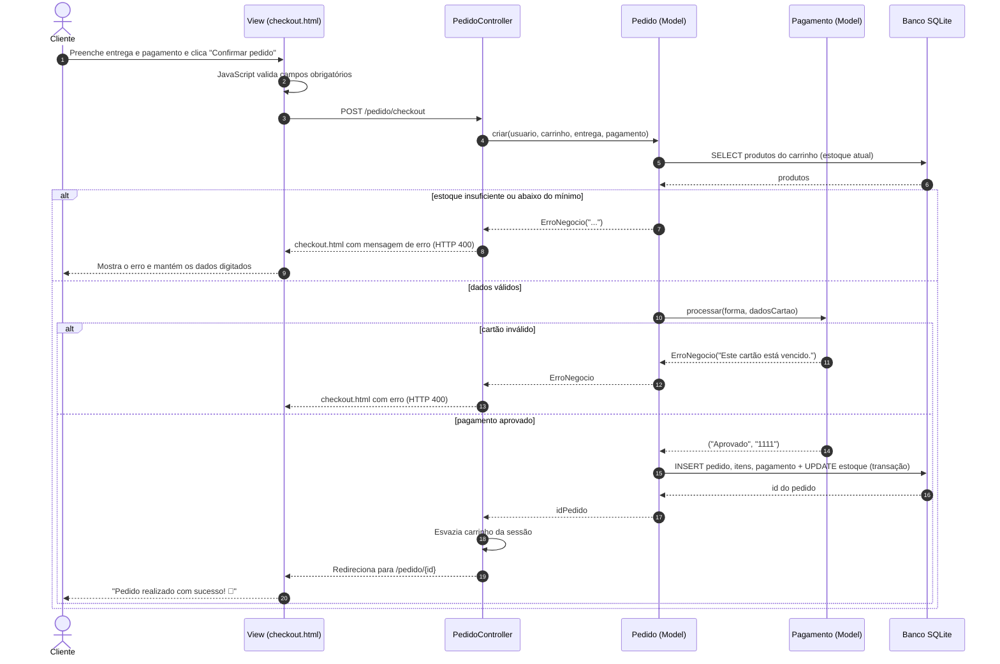
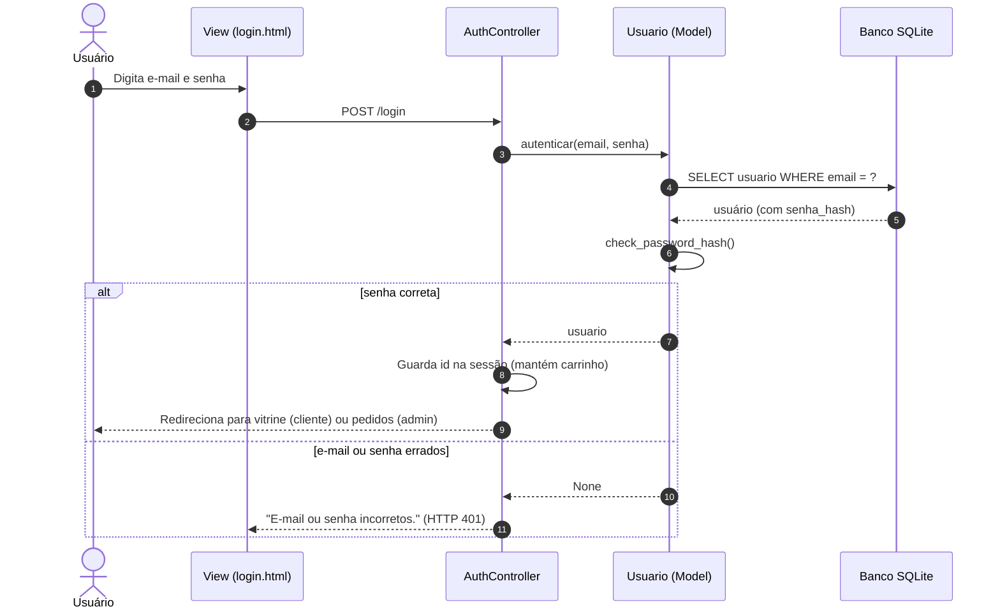
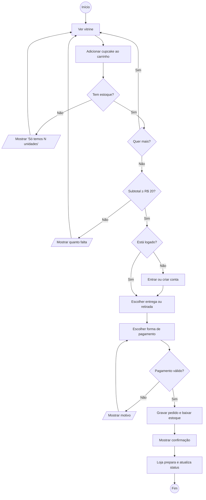
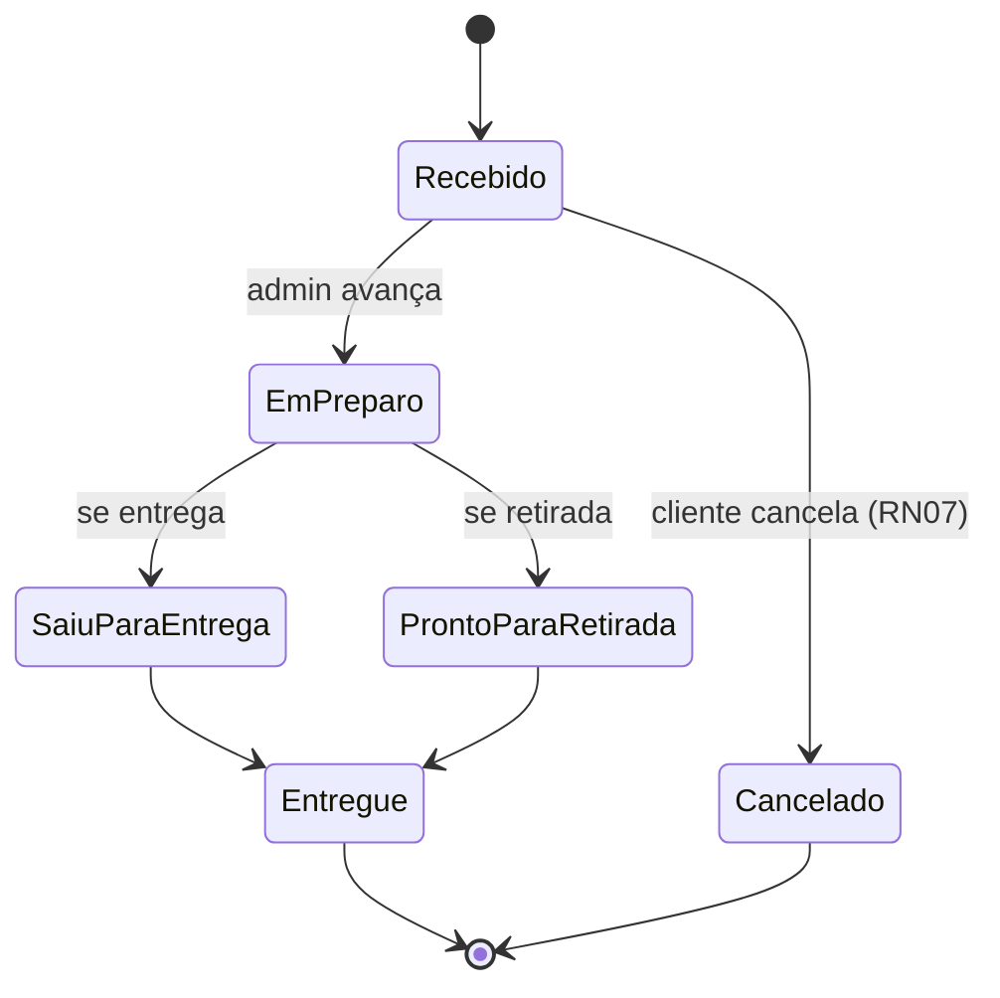

# 2. Modelagem UML (revisada)

Os diagramas estão escritos em **Mermaid**, que o GitHub desenha automaticamente ao abrir este arquivo.

## 2.1 Diagrama de casos de uso geral

> O Cliente herda tudo o que o Visitante pode fazer (generalização entre atores).

## 2.2 Casos de uso expandidos

### UC06 – Finalizar pedido

| Campo | Descrição |
|---|---|
| **Identificador** | UC06 |
| **Ator principal** | Cliente |
| **Descrição** | O cliente confirma os itens do carrinho, escolhe como receber e paga. |
| **Pré-condições** | Cliente logado; carrinho com subtotal ≥ R$ 20,00 (RN03). |
| **Pós-condições** | Pedido gravado com status "Recebido", pagamento registrado, estoque baixado e carrinho esvaziado. |

**Fluxo básico**

1. O caso de uso começa quando o cliente clica em "Finalizar pedido" na TELA05 – Carrinho.
2. O sistema verifica se o cliente está logado. *<Fluxo alternativo A>*
3. O sistema exibe a TELA06 – Checkout com o resumo dos itens, subtotal, taxa e total.
4. O cliente escolhe "Entrega em casa" ou "Retirar na loja". *<Fluxo alternativo B>*
5. O sistema recalcula o total na hora (RN04).
6. O cliente informa o endereço de entrega.
7. O cliente escolhe a forma de pagamento (inclui UC07 – Pagar pedido).
8. O cliente clica em "Confirmar pedido".
9. O sistema confere de novo o estoque de cada item (RN05). *<Fluxo alternativo C>*
10. O sistema confere o pedido mínimo (RN03) e o endereço. *<Fluxo alternativo D>*
11. O sistema processa o pagamento (RN06). *<Fluxo alternativo E>*
12. O sistema grava, numa única transação, o pedido, os itens, a baixa de estoque e o pagamento.
13. O sistema esvazia o carrinho e exibe a TELA08 – Detalhe do pedido com a mensagem "Pedido realizado com sucesso!".
14. O caso de uso termina.

**Fluxos alternativos**

- **A – Cliente não está logado:** A2. O sistema mostra "Entre na sua conta para continuar" e leva para a TELA03 – Login. A3. Depois do login, o cliente volta ao checkout com o carrinho mantido.
- **B – Retirada na loja:** B4. O sistema esconde o campo de endereço e zera a taxa. B5. O fluxo continua no passo 7.
- **C – Estoque insuficiente:** C9. O sistema mostra "Não há estoque suficiente de [cupcake]. Ajuste o carrinho." C10. Nada é gravado e o cliente continua no checkout.
- **D – Endereço incompleto:** D10. O sistema mostra "Informe o endereço completo para entrega (rua, número e bairro)." e mantém os dados já digitados.
- **E – Pagamento recusado:** E11. O sistema mostra o motivo (ex.: "Este cartão está vencido."). E12. Nada é gravado; o cliente pode corrigir os dados ou escolher outra forma.

### UC07 – Pagar pedido

| Campo | Descrição |
|---|---|
| **Identificador** | UC07 |
| **Ator principal** | Cliente |
| **Pré-condições** | Estar no passo 7 do UC06. |
| **Pós-condições** | Pagamento "Aprovado" (PIX/cartão) ou "Pendente" (dinheiro). |

**Fluxo básico (cartão)**

1. O cliente escolhe "Cartão de crédito".
2. O sistema exibe os campos número, validade e CVV, com máscara.
3. O cliente preenche os dados.
4. O sistema valida: 16 dígitos, algoritmo de Luhn, validade não vencida, CVV com 3 dígitos (RN06). *<Fluxo alternativo A>*
5. O sistema aprova o pagamento e guarda só os 4 últimos dígitos (RNF03).

**Fluxos alternativos**

- **A – Dado de cartão inválido:** A4. O sistema mostra a mensagem do erro específico e volta ao passo 3.
- **B – PIX:** o pagamento é aprovado na confirmação (simulação).
- **C – Dinheiro na entrega:** o pagamento fica "Pendente" e passa para "Aprovado" quando o administrador marca o pedido como "Entregue".

### UC10 – Gerenciar pedidos da loja

| Campo | Descrição |
|---|---|
| **Identificador** | UC10 |
| **Ator principal** | Administrador |
| **Pré-condições** | Usuário logado com perfil "admin". |
| **Pós-condições** | Status do pedido atualizado. |

**Fluxo básico**

1. O administrador acessa "Pedidos da loja".
2. O sistema lista os pedidos do mais novo para o mais antigo.
3. O administrador pode filtrar por status.
4. O administrador clica no botão da próxima etapa (ex.: "→ Em preparo").
5. O sistema atualiza o status seguindo a ordem da RN08 e mostra a confirmação.

**Fluxos alternativos**

- **A – Pedido já entregue ou cancelado:** o sistema não mostra botão de ação.
- **B – Usuário sem perfil admin:** o sistema mostra a página de erro 403.

## 2.3 Diagrama de classes (persistência)

- **Composição** (losango cheio): `ItemPedido` e `Pagamento` não existem sem o `Pedido`. Se o pedido for apagado, eles também são (`ON DELETE CASCADE`).
- **Agregação** (losango vazio): o `Produto` pertence a uma `Categoria`, mas faz sentido sozinho.
- O `Carrinho` não é persistido no banco; ele vive na sessão do navegador até virar um `Pedido`.

## 2.4 Diagrama de sequência – Finalizar pedido (MVC)

## 2.5 Diagrama de sequência – Login

## 2.6 Diagrama de atividades – Processo de compra

## 2.7 Diagrama de estados – Pedido

