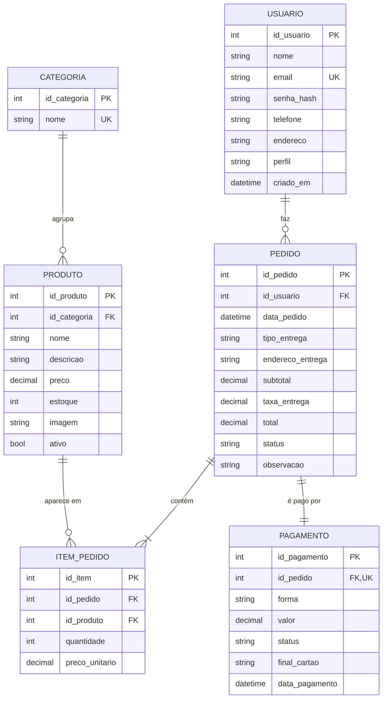

# 3. Projeto do banco de dados

**SGBD escolhido:** SQLite 3, o banco de dados mais usado do mundo (vem embutido no Python, Android, iOS e navegadores). Não precisa de servidor nem instalação, o que facilita os testes dos colegas e a correção pelos tutores. O script usa SQL padrão e pode ser levado para **MySQL** ou **PostgreSQL** trocando só `INTEGER PRIMARY KEY AUTOINCREMENT` por `INT AUTO_INCREMENT PRIMARY KEY` (MySQL) ou `SERIAL PRIMARY KEY` (PostgreSQL).

Arquivos:
- [`database/schema.sql`](../../database/schema.sql) – criação das tabelas (projeto físico)
- [`database/seed.sql`](../../database/seed.sql) – dados iniciais (categorias e cupcakes)

## 3.1 Projeto conceitual (Diagrama Entidade-Relacionamento)

**Cardinalidades**

| Relacionamento | Cardinalidade | Leitura |
|---|---|---|
| Usuário – Pedido | 1 : N | Um usuário faz zero ou vários pedidos; cada pedido é de um só usuário. |
| Categoria – Produto | 1 : N | Uma categoria tem vários cupcakes; cada cupcake tem uma categoria. |
| Pedido – Produto | N : N | Resolvido pela entidade associativa **ITEM_PEDIDO**, que guarda quantidade e preço da época. |
| Pedido – Pagamento | 1 : 1 | Cada pedido tem exatamente um pagamento (garantido por `UNIQUE` em `pagamento.id_pedido`). |

## 3.2 Projeto lógico (modelo relacional normalizado)

Notação: <u>sublinhado</u> = chave primária, `#` = chave estrangeira.

- **usuario** (<u>id_usuario</u>, nome, email, senha_hash, telefone, endereco, perfil, criado_em)
- **categoria** (<u>id_categoria</u>, nome)
- **produto** (<u>id_produto</u>, #id_categoria → categoria, nome, descricao, preco, estoque, imagem, ativo)
- **pedido** (<u>id_pedido</u>, #id_usuario → usuario, data_pedido, tipo_entrega, endereco_entrega, subtotal, taxa_entrega, total, status, observacao)
- **item_pedido** (<u>id_item</u>, #id_pedido → pedido, #id_produto → produto, quantidade, preco_unitario)
- **pagamento** (<u>id_pagamento</u>, #id_pedido → pedido [único], forma, valor, status, final_cartao, data_pagamento)

### Normalização

| Forma normal | Como o modelo atende |
|---|---|
| **1FN** – valores atômicos, sem grupos repetidos | Os itens do pedido não ficam numa coluna "lista de produtos"; cada item é uma linha em `item_pedido`. |
| **2FN** – sem dependência parcial da chave | Todas as tabelas têm chave primária simples (um só campo), então não há dependência parcial. |
| **3FN** – sem dependência transitiva | O nome da categoria fica em `categoria`, e não repetido em cada produto. Os dados do pagamento ficam em `pagamento`, e não misturados em `pedido`. |

**Desnormalizações conscientes**

- `item_pedido.preco_unitario` repete o preço do produto **de propósito**: se a loja mudar o preço amanhã, os pedidos antigos continuam com o valor que o cliente realmente pagou.
- `pedido.subtotal` e `pedido.total` são calculáveis a partir dos itens, mas ficam gravados como registro fiscal do momento da compra.
- `pedido.endereco_entrega` copia o endereço porque o cliente pode mudar de endereço depois.

## 3.3 Projeto físico

O projeto físico está em [`database/schema.sql`](../../database/schema.sql). Destaques:

- `PRAGMA foreign_keys = ON` para o SQLite respeitar as chaves estrangeiras.
- Restrições `CHECK` impõem o **domínio** de cada campo (ex.: `preco > 0`, `estoque >= 0`, `status IN (...)`), além do tipo de dado.
- `ON DELETE CASCADE` em `item_pedido` e `pagamento` (composição).
- Índices em `produto(id_categoria)`, `pedido(id_usuario)` e `item_pedido(id_pedido)`, que são as colunas mais consultadas.

## 3.4 Dicionário de dados

### Tabela `usuario`
Pessoas que usam o sistema: clientes e administradores.

| Campo | Tipo | Nulo? | Chave | Domínio / Regra | Descrição |
|---|---|---|---|---|---|
| id_usuario | INTEGER | Não | PK | Autoincremento | Identificador do usuário |
| nome | VARCHAR(100) | Não | | Mín. 3 caracteres | Nome completo |
| email | VARCHAR(120) | Não | UK | Formato de e-mail, gravado em minúsculas (RN01) | Login do usuário |
| senha_hash | VARCHAR(255) | Não | | Hash gerado pelo Werkzeug (RNF02) | Senha criptografada |
| telefone | VARCHAR(20) | Sim | | | Telefone para contato |
| endereco | VARCHAR(200) | Sim | | | Endereço padrão de entrega |
| perfil | VARCHAR(10) | Não | | `cliente` ou `admin`; padrão `cliente` | Nível de acesso |
| criado_em | DATETIME | Não | | Padrão: data/hora atual | Data do cadastro |

### Tabela `categoria`
Agrupamento dos cupcakes na vitrine.

| Campo | Tipo | Nulo? | Chave | Domínio / Regra | Descrição |
|---|---|---|---|---|---|
| id_categoria | INTEGER | Não | PK | Autoincremento | Identificador da categoria |
| nome | VARCHAR(50) | Não | UK | Único | Nome (Clássicos, Gourmet, Veganos, Datas especiais) |

### Tabela `produto`
Cupcakes vendidos pela loja.

| Campo | Tipo | Nulo? | Chave | Domínio / Regra | Descrição |
|---|---|---|---|---|---|
| id_produto | INTEGER | Não | PK | Autoincremento | Identificador do cupcake |
| id_categoria | INTEGER | Não | FK → categoria | Categoria existente | Categoria do cupcake |
| nome | VARCHAR(80) | Não | | Mín. 3 caracteres | Nome do sabor |
| descricao | VARCHAR(300) | Sim | | | Descrição mostrada na vitrine |
| preco | DECIMAL(8,2) | Não | | `> 0` | Preço unitário em reais |
| estoque | INTEGER | Não | | `>= 0`; padrão 0 | Unidades disponíveis hoje |
| imagem | VARCHAR(10) | Não | | Emoji; padrão 🧁 | Ícone exibido na vitrine |
| ativo | INTEGER | Não | | 0 ou 1; padrão 1 | 1 = aparece na vitrine |

### Tabela `pedido`
Cabeçalho de cada compra.

| Campo | Tipo | Nulo? | Chave | Domínio / Regra | Descrição |
|---|---|---|---|---|---|
| id_pedido | INTEGER | Não | PK | Autoincremento | Número do pedido |
| id_usuario | INTEGER | Não | FK → usuario | Usuário existente | Cliente que fez o pedido |
| data_pedido | DATETIME | Não | | Padrão: data/hora atual | Momento da compra |
| tipo_entrega | VARCHAR(10) | Não | | `entrega` ou `retirada` | Como o cliente vai receber |
| endereco_entrega | VARCHAR(200) | Sim | | Obrigatório (mín. 10 caracteres) se `tipo_entrega = entrega` | Endereço usado nesta entrega |
| subtotal | DECIMAL(8,2) | Não | | `>= 0`; `>= 20,00` na criação (RN03) | Soma dos itens |
| taxa_entrega | DECIMAL(8,2) | Não | | 7,00 para entrega; 0 para retirada (RN04) | Taxa cobrada |
| total | DECIMAL(8,2) | Não | | `subtotal + taxa_entrega` | Valor final |
| status | VARCHAR(20) | Não | | Recebido, Em preparo, Saiu para entrega, Pronto para retirada, Entregue, Cancelado (RN08) | Andamento do pedido |
| observacao | VARCHAR(200) | Sim | | | Recado do cliente para a loja |

### Tabela `item_pedido`
Cupcakes de cada pedido (entidade associativa entre pedido e produto).

| Campo | Tipo | Nulo? | Chave | Domínio / Regra | Descrição |
|---|---|---|---|---|---|
| id_item | INTEGER | Não | PK | Autoincremento | Identificador do item |
| id_pedido | INTEGER | Não | FK → pedido | `ON DELETE CASCADE` | Pedido ao qual pertence |
| id_produto | INTEGER | Não | FK → produto | Produto existente | Cupcake comprado |
| quantidade | INTEGER | Não | | `> 0` e `<=` estoque (RN05) | Unidades compradas |
| preco_unitario | DECIMAL(8,2) | Não | | `> 0` | Preço do cupcake no momento da compra |

### Tabela `pagamento`
Pagamento de cada pedido (1 para 1).

| Campo | Tipo | Nulo? | Chave | Domínio / Regra | Descrição |
|---|---|---|---|---|---|
| id_pagamento | INTEGER | Não | PK | Autoincremento | Identificador do pagamento |
| id_pedido | INTEGER | Não | FK → pedido, UK | Um pagamento por pedido; `ON DELETE CASCADE` | Pedido pago |
| forma | VARCHAR(10) | Não | | `pix`, `cartao` ou `dinheiro` | Forma de pagamento |
| valor | DECIMAL(8,2) | Não | | `>= 0`; igual ao total do pedido | Valor pago |
| status | VARCHAR(12) | Não | | Pendente, Aprovado, Recusado, Estornado | Situação do pagamento |
| final_cartao | VARCHAR(4) | Sim | | Só os 4 últimos dígitos (RNF03) | Identificação do cartão |
| data_pagamento | DATETIME | Não | | Padrão: data/hora atual | Momento do pagamento |
