# 4. Interface Humano-Computador (IHC)

## 4.1 Princípios aplicados

| Princípio (material da disciplina) | Como foi aplicado |
|---|---|
| **Clara** | Linguagem simples nos botões ("Adicionar", "Finalizar pedido"). Cada tela tem um título que diz onde o usuário está. |
| **Consistente** | Mesma cor (rosa) para todas as ações principais; mesmo menu e rodapé em todas as telas; mensagens sempre no topo, com a mesma cor por tipo. |
| **Simples** | Só três passos no checkout (receber → pagar → observações). Campos de cartão e endereço só aparecem quando são necessários (divulgação progressiva). |
| **Controlada pelo usuário** | Nada acontece sozinho; o usuário pode alterar ou remover itens a qualquer momento. |
| **Direta** | O total muda na hora ao trocar entrega/retirada; o contador do carrinho no topo muda ao adicionar. |
| **Empática e reversível** | Pode cancelar o pedido enquanto não está em preparo; o administrador "tira da vitrine" em vez de apagar; ação de cancelar pede confirmação. |
| **Dá resposta (feedback)** | Toda ação mostra mensagem verde (sucesso), amarela (aviso) ou vermelha (erro). Erros de formulário aparecem embaixo do campo. |
| **Esteticamente agradável** | Paleta rosa e chocolate (tema confeitaria), cartões com cantos arredondados, bastante espaço em branco. |

**Acessibilidade:** rótulos (`label`) em todos os campos, link "Pular para o conteúdo", foco visível ao navegar com Tab, mensagens com `aria-live` (lidas por leitores de tela), emojis decorativos com `aria-hidden`, idioma `pt-BR` declarado e layout que funciona a partir de 360 px.

## 4.2 Mapa navegacional

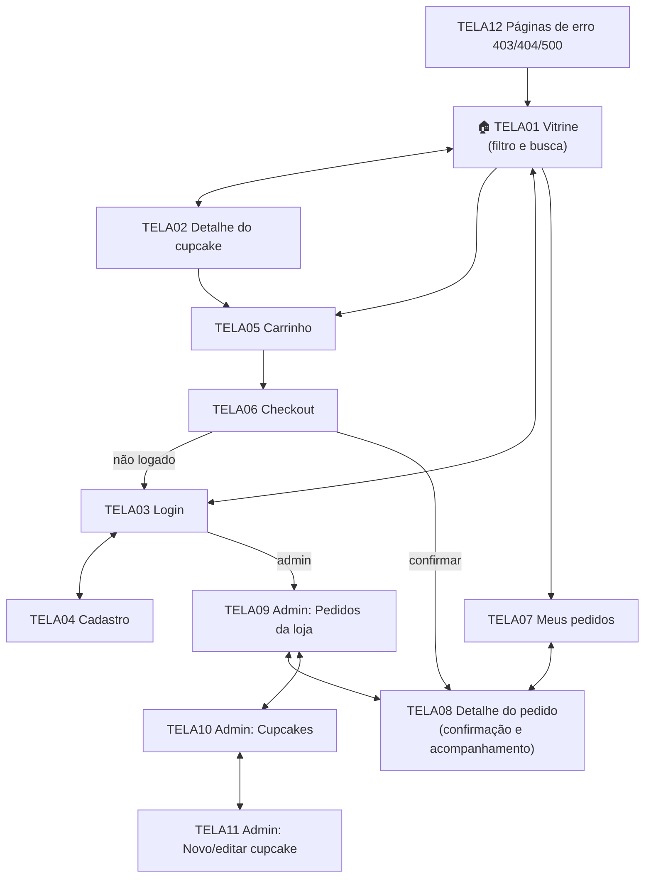

## 4.3 Mapa conceitual

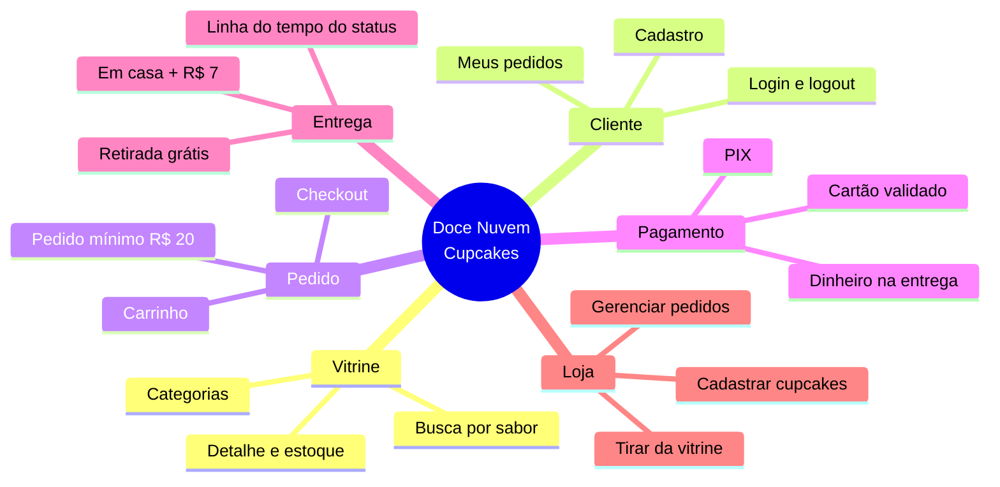

## 4.4 Telas (protótipo funcional)

As imagens abaixo são prints do sistema funcionando. Elas substituem os wireframes do PITE I, já que agora o protótipo virou o produto.

| Tela | Imagem |
|---|---|
| TELA01 – Vitrine | 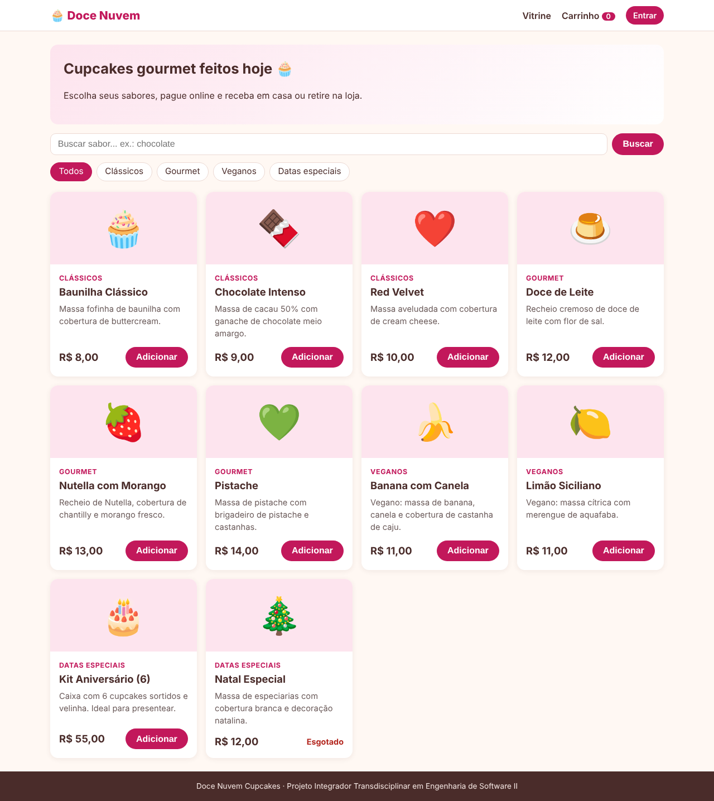 |
| TELA01 – Vitrine no celular | 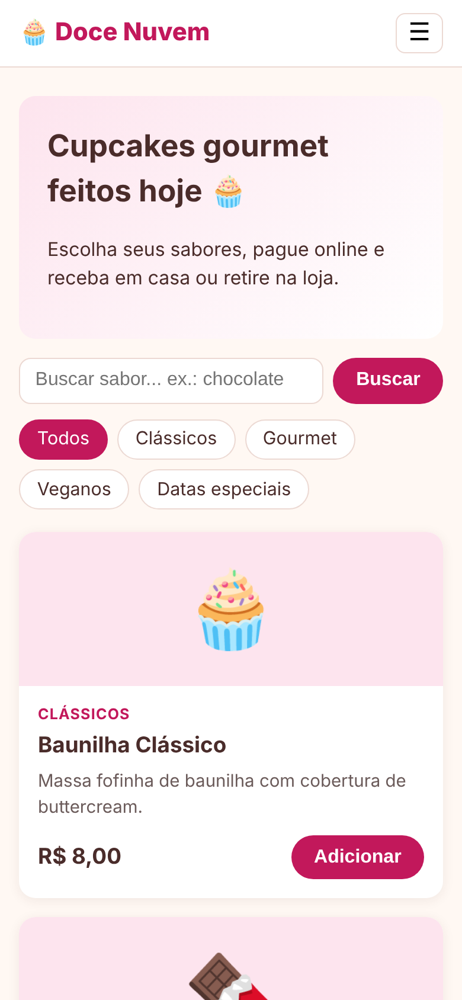 |
| TELA02 – Detalhe do cupcake | 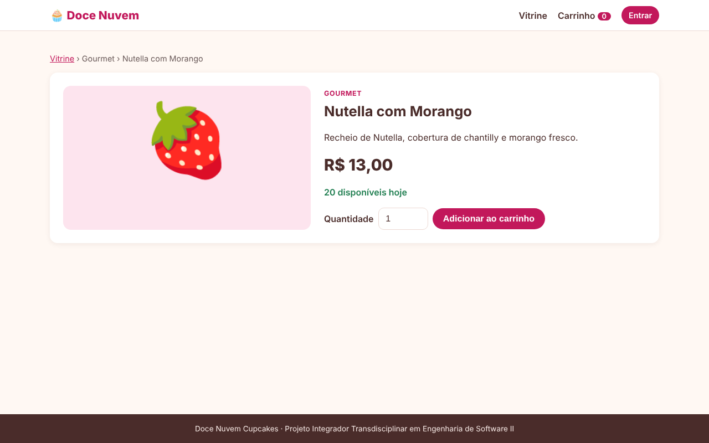 |
| TELA04 – Cadastro com erros | 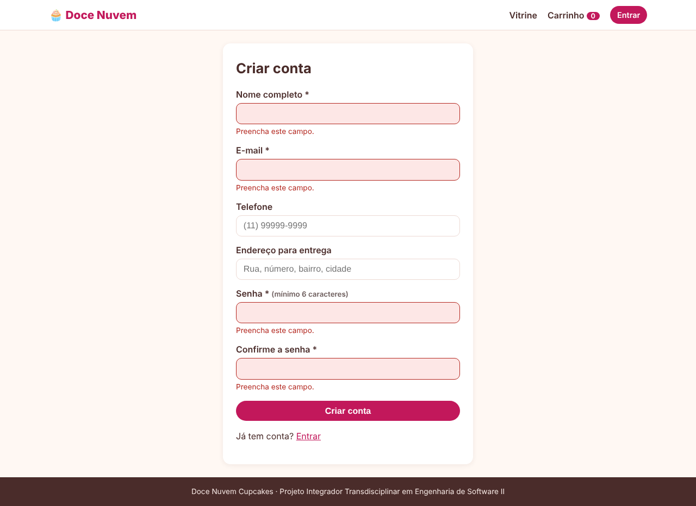 |
| TELA05 – Carrinho | 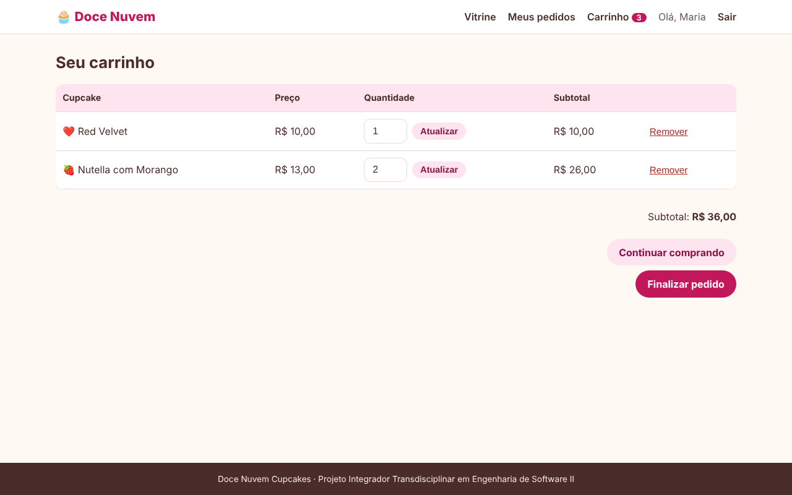 |
| TELA06 – Checkout |  |
| TELA06 – Checkout com cartão inválido | 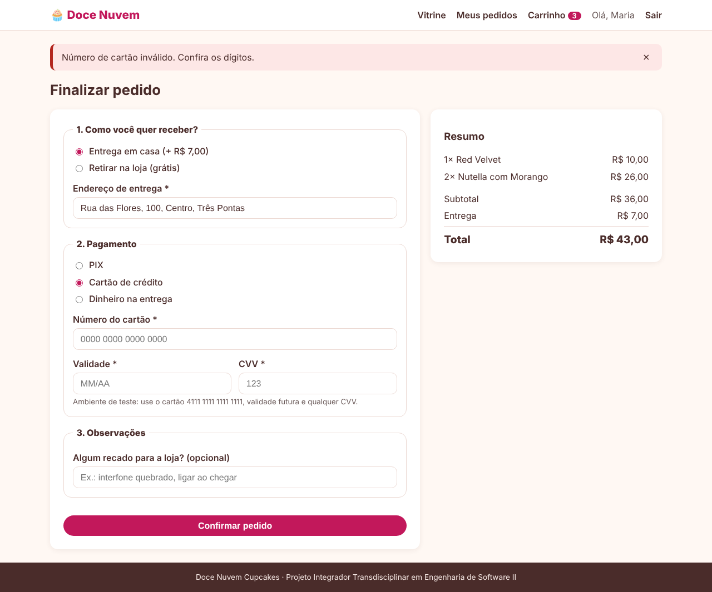 |
| TELA08 – Pedido confirmado | 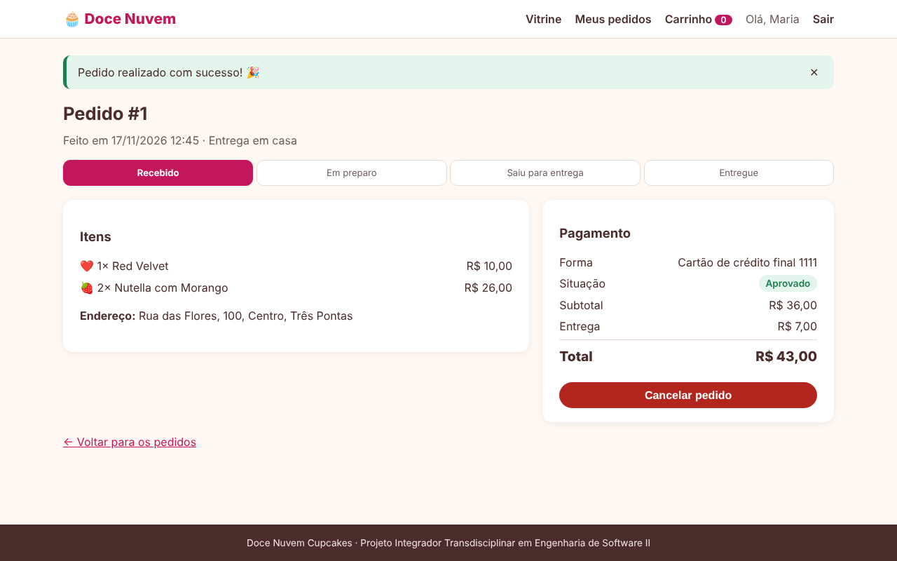 |
| TELA07 – Meus pedidos | 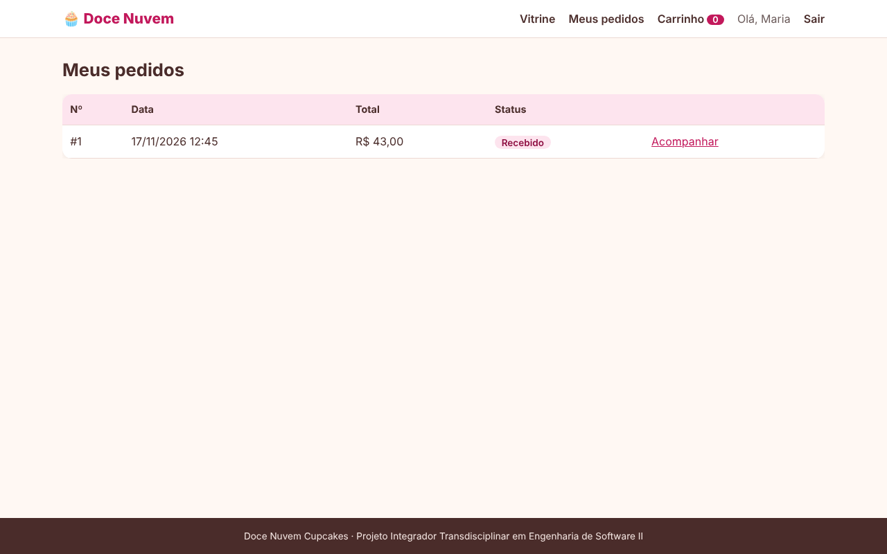 |
| TELA03 – Login com erro | 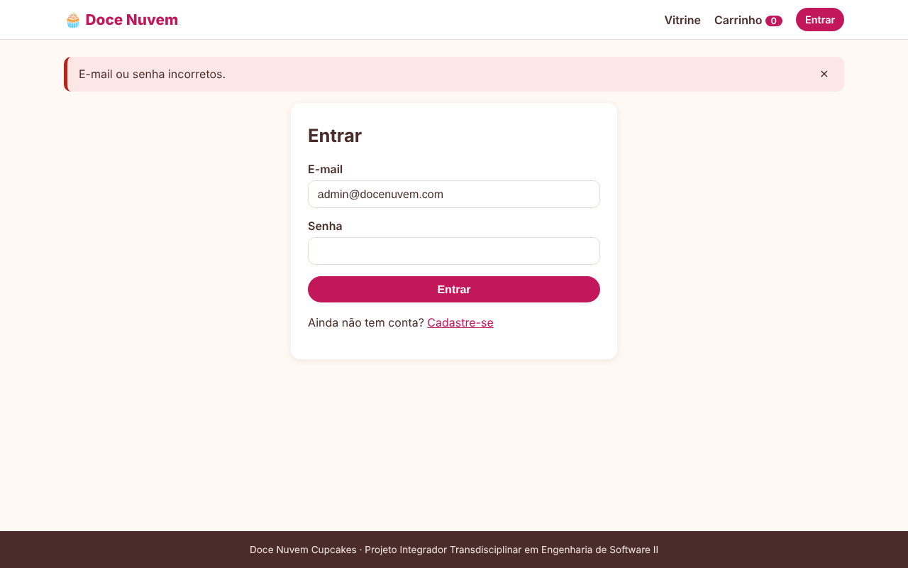 |
| TELA09 – Admin: pedidos | 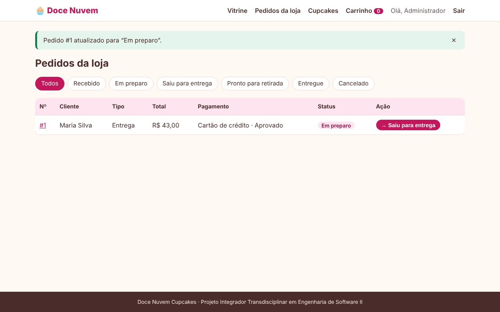 |
| TELA10 – Admin: cupcakes | 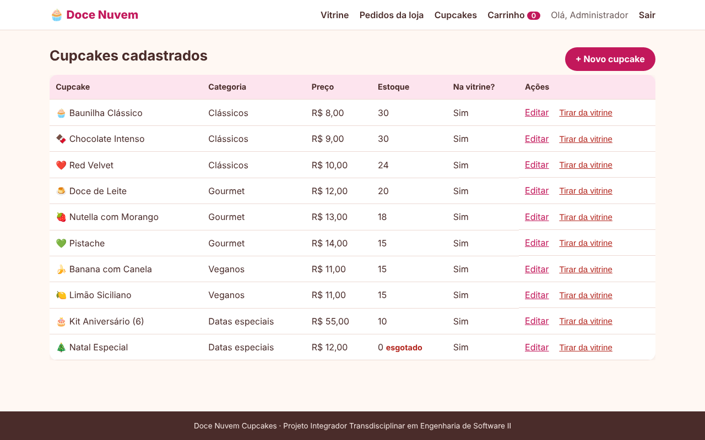 |
| TELA11 – Admin: novo cupcake | 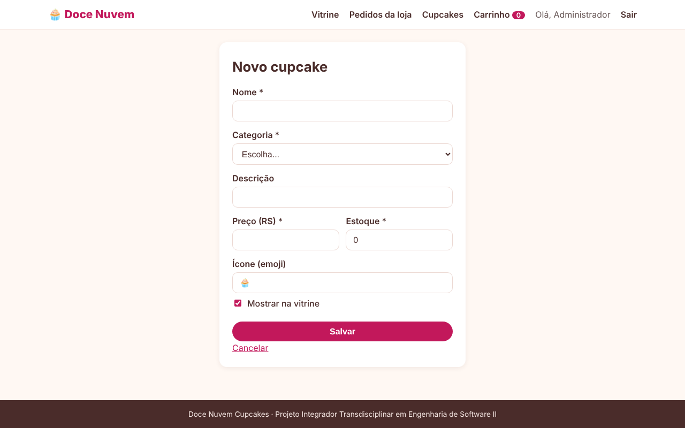 |
| TELA12 – Erro 404 | 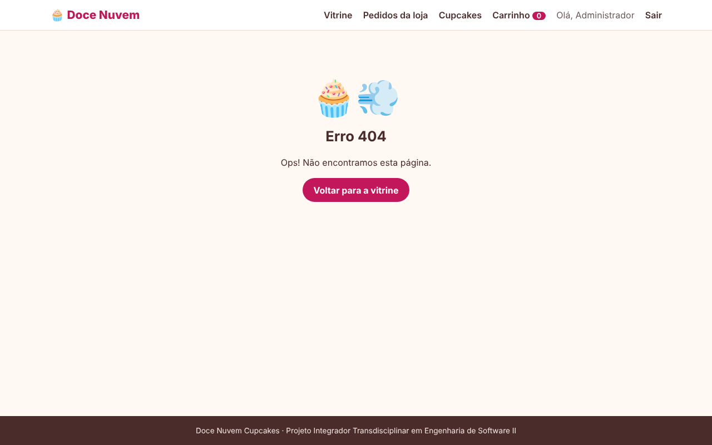 |

## 4.5 Catálogo de mensagens

| Situação | Mensagem | Tipo |
|---|---|---|
| Campo obrigatório vazio | Preencha este campo. | Erro (no campo) |
| E-mail mal digitado | Informe um e-mail válido, por exemplo: nome@email.com. | Erro |
| Senha curta | A senha precisa ter pelo menos 6 caracteres. | Erro |
| Senhas diferentes | A confirmação de senha não confere. | Erro |
| E-mail já usado | Este e-mail já está cadastrado. Faça login ou use outro e-mail. | Erro |
| Login errado | E-mail ou senha incorretos. | Erro |
| Página restrita sem login | Entre na sua conta para continuar. | Aviso |
| Acima do estoque | Só temos N unidade(s) de [cupcake] no momento. | Erro |
| Produto esgotado | [Cupcake] está esgotado. | Erro |
| Abaixo do mínimo | O pedido mínimo é de R$ 20,00. Faltam R$ X. | Aviso |
| Endereço incompleto | Informe o endereço completo para entrega (rua, número e bairro). | Erro |
| Cartão curto | O número do cartão deve ter 16 dígitos. | Erro |
| Cartão inválido | Número de cartão inválido. Confira os dígitos. | Erro |
| Cartão vencido | Este cartão está vencido. | Erro |
| Validade errada | Validade inválida. Use o formato MM/AA, por exemplo 08/28. | Erro |
| CVV errado | O CVV deve ter 3 dígitos (verso do cartão). | Erro |
| Pedido feito | Pedido realizado com sucesso! 🎉 | Sucesso |
| Cancelar em preparo | Este pedido já está em preparo e não pode mais ser cancelado. | Erro |
| Página inexistente | Ops! Não encontramos esta página. | Erro 404 |
| Sem permissão | Você não tem permissão para acessar esta página. | Erro 403 |
| Falha no servidor | Algo deu errado do nosso lado. Tente de novo em instantes. | Erro 500 |
