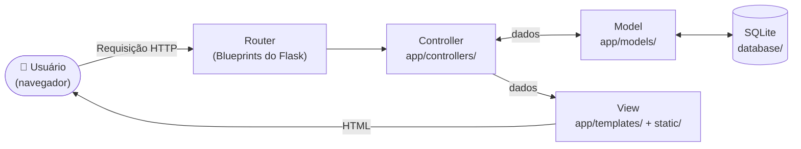

# Arquitetura da solução (padrão MVC)

## Tecnologias

| Camada | Tecnologia | Por quê |
|---|---|---|
| Front-end | HTML5, CSS3 (sem framework) e JavaScript puro | Pedido da disciplina; leve e funciona em qualquer navegador. |
| Back-end | **Python 3** com **Flask** | Linguagem sugerida na disciplina; Flask é simples e organiza bem o MVC. |
| Banco de dados | **SQLite 3** | SGBD mais usado do mundo, sem instalação; script compatível com MySQL/PostgreSQL. |
| Testes | **pytest** | Ferramenta de testes unitários indicada no material (Pytest). |
| Versionamento | Git + GitHub | Exigência da disciplina; portfólio permanente. |

## Como o MVC foi organizado



| Camada | Pasta | Responsabilidade | Arquivos |
|---|---|---|---|
| **Model** | `app/models/` | Regras de negócio, validações e acesso ao banco. Não sabe nada de HTML. | `usuario.py`, `produto.py`, `carrinho.py`, `pedido.py`, `pagamento.py`, `erros.py` |
| **View** | `app/templates/` e `app/static/` | O que o usuário vê: páginas HTML (Jinja2), estilo CSS e interações em JavaScript. | `base.html`, `loja/`, `auth/`, `carrinho/`, `pedido/`, `admin/`, `erros/`, `css/style.css`, `js/main.js` |
| **Controller** | `app/controllers/` | Recebe a requisição, chama o Model e escolhe a View. É o "cérebro" que liga as duas. | `loja_controller.py`, `auth_controller.py`, `carrinho_controller.py`, `pedido_controller.py`, `admin_controller.py` |

### Exemplo do caminho de uma requisição

Quando o cliente clica em **Adicionar** na vitrine:

1. O navegador envia `POST /carrinho/adicionar/4`.
2. O **Controller** `carrinho_controller.adicionar()` lê a quantidade do formulário.
3. Ele chama o **Model** `carrinho.adicionar()`, que busca o produto no banco e confere o estoque (RN05).
4. Se der certo, o Controller guarda o carrinho na sessão e cria a mensagem "Cupcake adicionado ao carrinho!".
5. Se der errado, o Model lança `ErroNegocio("Só temos N unidades…")` e o Controller transforma isso em mensagem de erro.
6. O usuário volta para a **View** da vitrine, já com a mensagem e o contador do carrinho atualizado.

## Tratamento de erros

- **Erros de regra de negócio** viram a exceção `ErroNegocio` no Model. O Controller captura e mostra a mensagem ao usuário (nunca uma tela técnica).
- **Validação dupla:** o JavaScript avisa os erros de preenchimento antes de enviar, e o servidor valida tudo de novo (o usuário poderia desligar o JavaScript).
- **Transação no pedido:** pedido, itens, baixa de estoque e pagamento são gravados juntos. Se qualquer passo falhar, é feito `rollback` e nada fica pela metade.
- **Páginas de erro próprias** para 403, 404 e 500.
- **Segurança:** senhas com hash, consultas SQL com parâmetros (`?`) contra SQL Injection, Jinja2 escapa HTML automaticamente contra XSS, redirecionamento após login só para endereços internos.

## Estrutura de pastas

```
cupcakes-app/
├── run.py                  # inicia o servidor
├── config.py               # configurações (taxa, pedido mínimo, banco)
├── requirements.txt        # bibliotecas (Flask, pytest)
├── app/
│   ├── __init__.py         # cria a aplicação e registra os controllers
│   ├── database.py         # conexão com o SQLite
│   ├── models/             # M
│   ├── controllers/        # C
│   ├── templates/          # V (HTML)
│   └── static/             # V (CSS e JS)
├── database/
│   ├── schema.sql          # projeto físico
│   └── seed.sql            # dados iniciais
├── tests/                  # testes automatizados (pytest)
└── docs/                   # documentação por situação-problema
```
