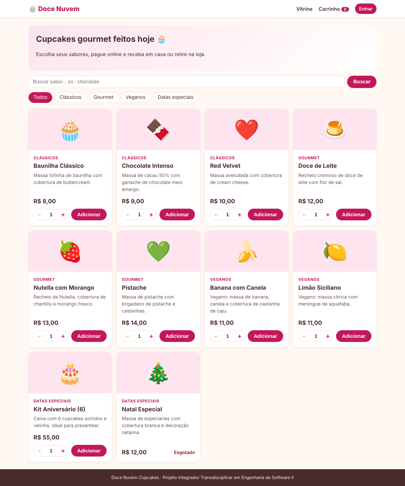
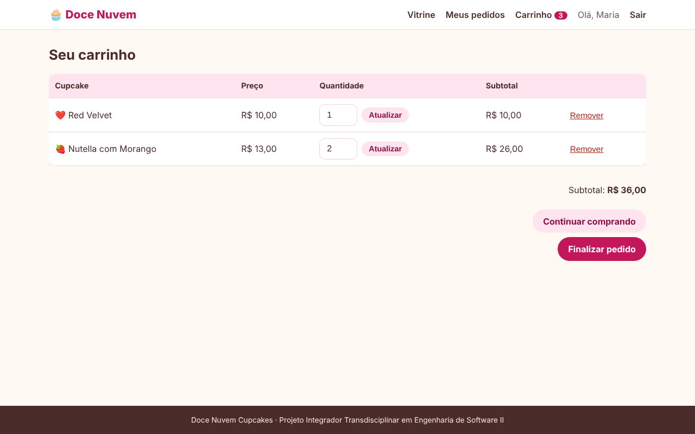
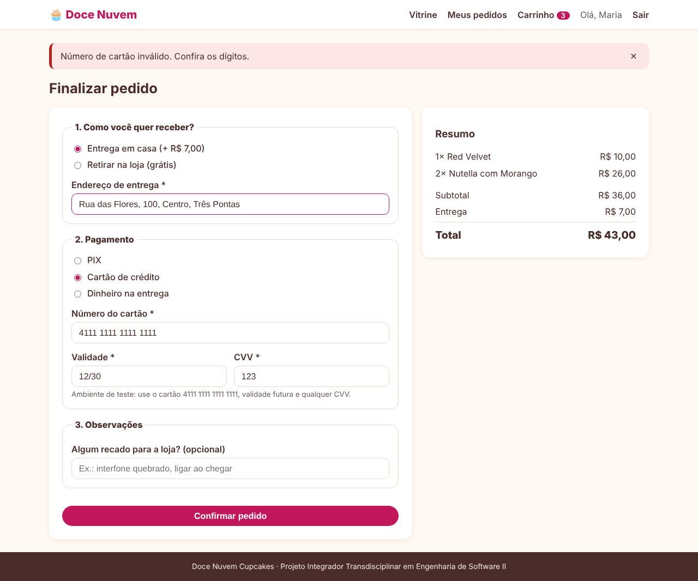
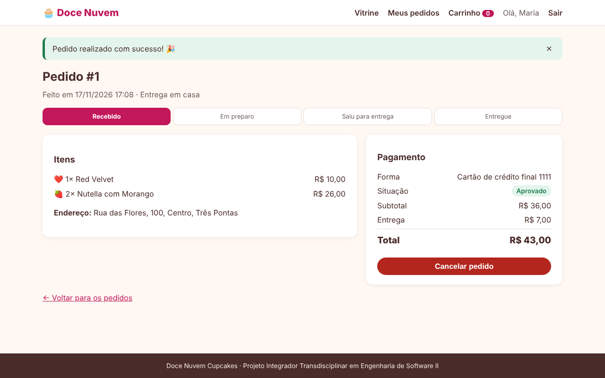
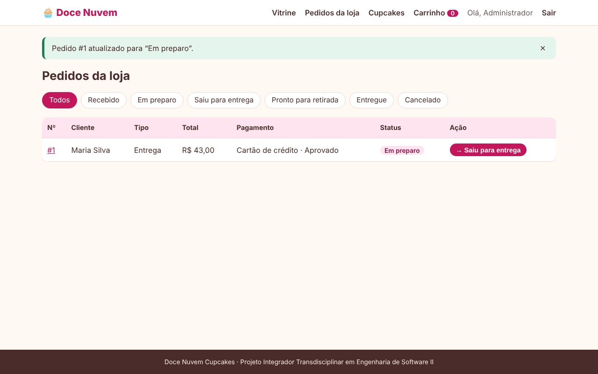
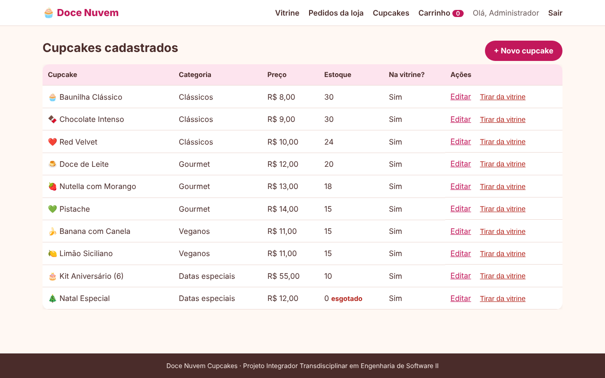

# Manual de uso – Doce Nuvem Cupcakes

## Como abrir o sistema

**Opção 1 – No navegador, sem instalar nada (GitHub Codespaces)**

1. Abra o repositório no GitHub.
2. Clique no botão verde **Code** → aba **Codespaces** → **Create codespace on main**.
3. Quando o terminal aparecer embaixo, digite:
   ```
   pip install -r requirements.txt
   python run.py
   ```
4. Vai aparecer um aviso "Your application running on port 5000 is available". Clique em **Open in Browser**.

**Opção 2 – No seu computador (precisa do Python 3 instalado)**

```
pip install -r requirements.txt
python run.py
```
Depois abra **http://127.0.0.1:5000** no navegador.

O banco de dados é criado sozinho na primeira vez, já com 10 cupcakes cadastrados.

### Usuários para teste

| Perfil | E-mail | Senha |
|---|---|---|
| Administrador da loja | admin@docenuvem.com | admin123 |
| Cliente | crie a sua conta em "Entrar" → "Cadastre-se" | |

**Cartão de teste:** `4111 1111 1111 1111`, qualquer validade futura (ex.: 12/30) e qualquer CVV (ex.: 123). O pagamento é simulado; nenhum valor é cobrado.

---

## Para o cliente

### 1. Escolher cupcakes
Na **vitrine** aparecem todos os cupcakes disponíveis. Você pode filtrar por categoria (Clássicos, Gourmet, Veganos, Datas especiais) ou buscar pelo sabor. Clique no nome para ver os detalhes e escolher a quantidade.



### 2. Montar o carrinho
Clique em **Adicionar**. O número ao lado de "Carrinho", no topo, aumenta. No carrinho você pode mudar a quantidade (0 remove o item) ou clicar em **Remover**. O pedido mínimo é de **R$ 20,00**.



### 3. Criar conta ou entrar
Para finalizar, é preciso ter conta. Clique em **Entrar** → **Cadastre-se**. Seu carrinho não se perde.

### 4. Finalizar o pedido
Em **Finalizar pedido**:
1. Escolha **Entrega em casa** (+ R$ 7,00) ou **Retirar na loja** (grátis).
2. Escolha a forma de pagamento: **PIX**, **Cartão de crédito** ou **Dinheiro na entrega**.
3. Se quiser, deixe um recado para a loja.
4. Clique em **Confirmar pedido**.



Se algum dado estiver errado, o sistema mostra o que corrigir e mantém o que você já digitou.

### 5. Acompanhar o pedido
Depois de confirmar, aparece a página do pedido com a linha do tempo: **Recebido → Em preparo → Saiu para entrega → Entregue**. Para voltar a ela, use **Meus pedidos** no menu.



### 6. Cancelar
Enquanto o pedido estiver como **Recebido**, aparece o botão **Cancelar pedido**. Depois que a loja começa a preparar, não dá mais para cancelar.

---

## Para a loja (administrador)

Entre com o usuário administrador. O menu mostra **Pedidos da loja** e **Cupcakes**.

### Gerenciar pedidos
A lista mostra os pedidos do mais novo para o mais antigo. Use os filtros de status no topo. Para avançar um pedido, clique no botão da próxima etapa (ex.: **→ Em preparo**). Em pedidos pagos em dinheiro, o pagamento vira "Aprovado" quando o pedido é marcado como **Entregue**.



### Gerenciar cupcakes
Em **Cupcakes** você vê todos os produtos, inclusive os que estão fora da vitrine.
- **+ Novo cupcake**: cadastra um sabor (nome, categoria, preço, estoque e um emoji como ícone).
- **Editar**: muda preço, estoque etc.
- **Tirar da vitrine**: esconde o cupcake dos clientes sem apagá-lo, para não perder o histórico dos pedidos.



---

## Rodar os testes automatizados

```
pytest
```
O resultado esperado é `51 passed`.

## Recriar o banco do zero

Apague o arquivo `database/cupcakes.db` e rode `python run.py` de novo.
