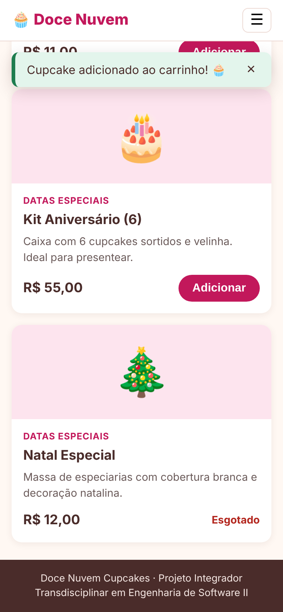
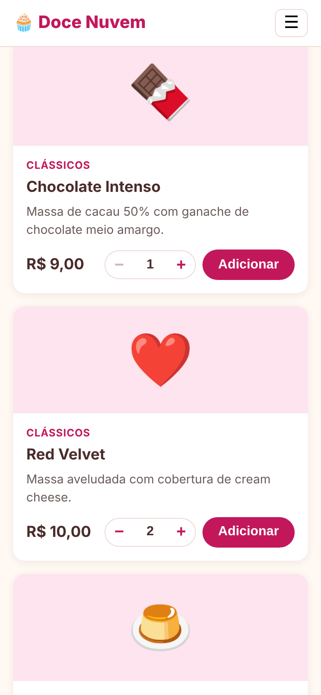
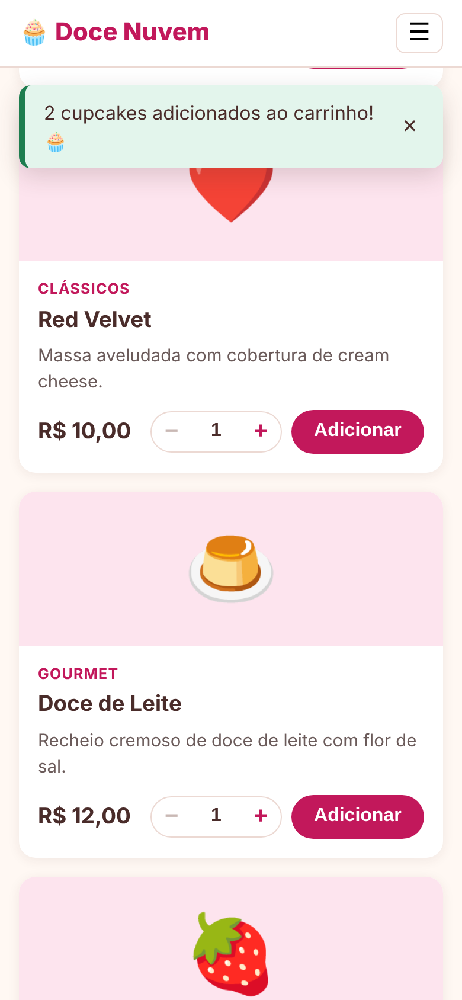

# Feedback dos testadores e melhorias aplicadas

Os colegas de curso foram convidados, mas não responderam até o prazo. O sistema foi então testado por **4 usuários externos ao curso**, que receberam o link, o roteiro de teste do [formulário](03-formulario-teste-usuarios.md) e responderam por mensagem, com prints e vídeos da tela. Todos testaram no celular.

## Resumo dos testes

| # | Testador | Data | Funcionou | Não funcionou | Não testou |
|---|---|---|---|---|---|
| 1 | Katharina | 17/11/2026 | Cadastro, pedido, confirmação e cancelamento | Nada | Área da loja; dados inválidos |
| 2 | Carvalho | 17/11/2026 | Cadastro, carrinho, cartão válido e inválido, login da loja, mudança de status. Achou o site intuitivo e organizado | Nada | Cancelamento; busca e filtro; retirada; PIX e dinheiro |
| 3 | Ju | 17/11/2026 | Cadastro, carrinho com aviso, cartão inválido recusado, cartão de teste aprovado, cancelamento e conferência na área da loja (pedido aparece como Cancelado / Estornado). Elogiou o design e o layout | Ao adicionar um cupcake, a página voltava para o topo toda vez | Busca e filtro; retirada; PIX e dinheiro |
| 4 | Ser | 17/11/2026 | Carrinho e aviso de pedido mínimo, atualizar quantidade no carrinho, mensagens de cartão com menos de 16 dígitos e de validade inválida, pedido com entrega e observação, cancelamento, Meus pedidos | Na vitrine, o botão Adicionar coloca 1 unidade direto e não deixa escolher a quantidade antes. Sugeriu botões de + e − | Busca e filtro; área da loja; retirada; PIX e dinheiro |

## Problemas e sugestões recebidos

| ID | Testador | Relato | Tipo | Decisão | O que foi feito | Status |
|---|---|---|---|---|---|---|
| FB-01 | Katharina | Nenhum erro encontrado | — | — | — | Sem pendências |
| FB-02 | Carvalho | Nenhum erro encontrado | — | — | — | Sem pendências |
| FB-03 | Ju | “Eu adicionei um cupcake e ele me leva direto pra cima, toda vez que eu colocava um cupcake.” | Usabilidade | Corrigir | Cada cupcake da vitrine ganhou uma âncora (`#produto-N`). Depois de adicionar, o sistema volta exatamente para o cupcake clicado, e a mensagem “Cupcake adicionado ao carrinho!” aparece flutuando na tela e some sozinha em 4 segundos. Criados 2 testes automatizados novos. | ✅ Corrigido |
| FB-04 | Ser | “Na hora de selecionar produtos ele já manda direto para o carrinho e não permite escolher a quantidade. Seria legal ter um botão de mais e menos para definir, por exemplo, duas unidades antes de adicionar.” | Usabilidade | Corrigir | Cada cupcake da vitrine (e a página de detalhe) ganhou um seletor de quantidade com botões − e +, limitado ao estoque disponível. A mensagem passou a dizer quantas unidades foram adicionadas (“2 cupcakes adicionados ao carrinho!”). Criados 2 testes automatizados novos. | ✅ Corrigido |

**Critério de decisão:** bugs que impedem comprar ou pagar são corrigidos na hora; problemas de usabilidade que atrapalham o uso comum (como o FB-03 e o FB-04) também. Sugestões que mudam o escopo vão para o backlog futuro descrito em [01-escopo-e-historias.md](../situacao-1-planejamento/01-escopo-e-historias.md).

 

## Bugs e melhorias encontrados nos testes internos

| ID | Descrição | Correção |
|---|---|---|
| BUG-01 | Botão “Criar conta” precisava de dois cliques depois de um envio com erros. | Mensagens de erro somem enquanto a pessoa digita; mensagens vazias não ocupam espaço. |
| MEL-01 | Data do pedido no fuso UTC e no formato americano. | Hora local e formato brasileiro (17/11/2026 14:05). |
| MEL-02 | Forma de pagamento aparecia como código (CARTAO) na área da loja. | Nome por extenso (Cartão de crédito, PIX, Dinheiro na entrega). |
| MEL-03 | Site só ficava no ar com o Codespaces aberto. | Publicado no PythonAnywhere: https://heloizajb.pythonanywhere.com |
